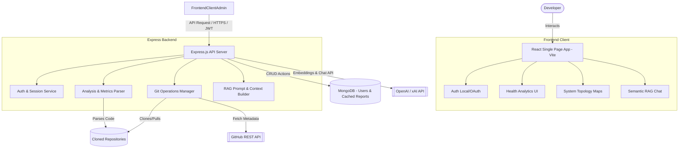

# RepoMind Explainer 

[](https://opensource.org/licenses/MIT)
[](https://nodejs.org/)
[](https://react.dev/)
[](https://tailwindcss.com/)
[](https://www.mongodb.com/)

RepoMind Explainer is a state-of-the-art developer intelligence dashboard designed to analyze, visualize, and explain GitHub repositories. By integrating AI-driven insights, interactive system topology maps, automated security audits, code staleness metrics, and a semantic RAG (Retrieval-Augmented Generation) chat engine, it enables developers to onboard onto complex codebases in minutes.

---

## 📖 Table of Contents
- [🚀 Key Features](#-key-features)
- [🏗️ System Architecture](#️-system-architecture)
- [🛠️ Tech Stack](#️-tech-stack)
- [📂 Directory Structure](#-directory-structure)
- [💻 Local Setup & Installation](#-local-setup--installation)
- [🎨 Design System & Aesthetics](#-design-system--aesthetics)
- [🔮 Future Scope](#-future-scope)
- [📄 License](#-license)

---

## 🚀 Key Features

### 📊 Repository Analytics & Health Score
Evaluates repositories across code quality, active maintenance, and security vulnerability density. Renders high-level health scores, visual performance indicators, and prioritized actionable onboarding guides.

### 🗺️ System Topology Maps
Dynamically parses directory trees and import patterns to automatically generate interactive system topology diagrams using Mermaid.js. Visualize routing structures, database connections, and component relationships instantly.

### 🛡️ Security Auditor
Automates dependency manifest scanning and source code auditing for leaked API credentials, high-severity dependencies (cross-referenced against vulnerability databases), and security vulnerabilities. Categorized into Critical, High, Medium, and Low risk thresholds.

### 🗑️ Dead Code & Staleness Detector
Scans commit history and file metadata to flag files untouched beyond specified configurations (30, 60, 90, or 180 days), highlighting code debt and potential candidates for refactoring.

### 💬 RAG-Powered Semantic Chat
Engage in context-aware conversations with the repository. Utilizes OpenAI/xAI vector embeddings and custom prompt pipelines to answer technical questions, explain functions, and locate files based on semantic code meaning.

### 🔑 Local & OAuth Authentication
Supports both secure local email/password registration (backed by `bcryptjs` password hashing and JWT sessions) and standard GitHub OAuth login integrations.

---

## 🏗️ System Architecture



---

## 🛠️ Tech Stack

- **Frontend**: React (Vite), Tailwind CSS, Framer Motion, Recharts (Visual Data Metrics), Lucide React (Icons), Mermaid.js.
- **Backend**: Node.js, Express.js, `simple-git` (Git operations manager), Mongoose (MongoDB ODM).
- **Authentication**: JSON Web Tokens (JWT), `bcryptjs` (Password hashing), GitHub OAuth 2.0.
- **AI & RAG Engine**: OpenAI & xAI APIs (text-embedding-3-small, custom completion models).
- **Database**: MongoDB (Local or Atlas cloud database).

---

## 📂 Directory Structure

```text
gitrepo-explainer/
├── backend/                   # Node.js + Express backend server
│   ├── controllers/           # Route handler controllers (Auth, Repo, Chat, etc.)
│   ├── middleware/            # JWT verification, rate limiting, and auth filters
│   ├── models/                # Mongoose Database Schemas (User, Repository, Report)
│   ├── routes/                # API Route declarations
│   ├── services/              # Business logic (Git operations, AI embeddings, parser)
│   ├── server.js              # Application entry point
│   └── package.json           # Backend dependency configuration
├── frontend/                  # React frontend web application
│   ├── public/                # Static public assets
│   ├── src/                   # React source code
│   │   ├── components/        # Reusable UI components (Navbar, Sidebar, Charts)
│   │   ├── pages/             # Dashboard, Login, Topology, Auditor, Chat
│   │   ├── context/           # React Global Context State (Auth, UI themes)
│   │   ├── App.jsx            # Application Router & Core Wrapper
│   │   └── main.jsx           # Vite React mounting point
│   ├── tailwind.config.js     # Tailwind CSS Configuration
│   └── package.json           # Frontend dependency configuration
└── temp_repos/                # Server-side directory for cloning analyzed repositories
```

---

## 💻 Local Setup & Installation

### Prerequisites
- Node.js (v18.0.0 or higher)
- MongoDB Server running locally on port `27017` (or MongoDB Atlas connection string)
- OpenAI API Key (or xAI API Key) for RAG Chat and code embeddings

---

### Step 1: Clone the Repository
```bash
git clone https://github.com/takoy4k1/github-repo-analyzer.git
cd github-repo-analyzer
```

---

### Step 2: Backend Setup
1. Navigate to the backend directory:
   ```bash
   cd backend
   ```
2. Install the backend dependencies:
   ```bash
   npm install
   ```
3. Create a `.env` file in the `backend/` directory:
   ```env
   PORT=5001
   MONGO_URI=mongodb://localhost:27017/repomind
   JWT_SECRET=your_jwt_secret_key_here
   XAI_API_KEY=your_openai_or_xai_api_key_here
   FRONTEND_URL=http://localhost:5173
   NODE_ENV=development
   ```
4. Start the backend development server:
   ```bash
   npm run dev
   ```

---

### Step 3: Frontend Setup
1. Navigate to the frontend directory:
   ```bash
   cd ../frontend
   ```
2. Install the frontend dependencies:
   ```bash
   npm install
   ```
3. Start the Vite local development server:
   ```bash
   npm run dev
   ```
4. Open your browser and navigate to the application:
   ```text
   http://localhost:5173
   ```

---

## 🎨 Design System & Aesthetics

RepoMind Explainer sports a premium, high-contrast visual interface with dark and light adaptive themes built on elegant color structures:

- **Cream Theme (Light)**:
  - Base Background: Soft Cream (`#fdfbf7`)
  - Accent Panels: Soft Ivory (`#f7f4ec`)
  - Borders: Warm Muted Slate (`#dfd9c8`)
  - Accent Branding: Deep Bronze Gold (`#422a0a`)
  - Text Primary: Charcoal Gray (`#242520`)
- **Charcoal Theme (Dark)**:
  - Base Background: Slate Black (`#0d1117`)
  - Accent Panels: Dark Steel (`#161b22`)
  - Borders: Muted Iron (`#30363d`)
  - Accent Branding: Soft Amber Gold (`#d4a373`)
  - Text Primary: Light Silver (`#c9d1d9`)

---

## 🔮 Future Scope

1. **Distributed Caching & Pipelines**: Integrate Redis cache and Bull queues for managing highly concurrent heavy git clones and embeddings generation.
2. **CI/CD Integration Hooks**: Support custom webhooks that automatically trigger dependency checks and security scanning on pull requests.
3. **Advanced ML Code Quality Metrics**: Leverage trained offline AST-based scanners for deep cyclomatic complexity mapping.
4. **Enhanced Collaborative Workspaces**: Share analysis results, annotations, and customized topology configurations with team members.

---

## 📄 License

This project is licensed under the MIT License. See the [LICENSE](LICENSE) file for more details.
